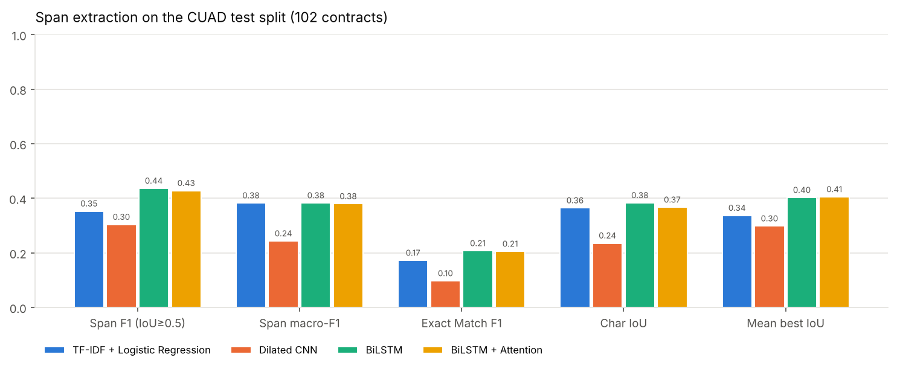
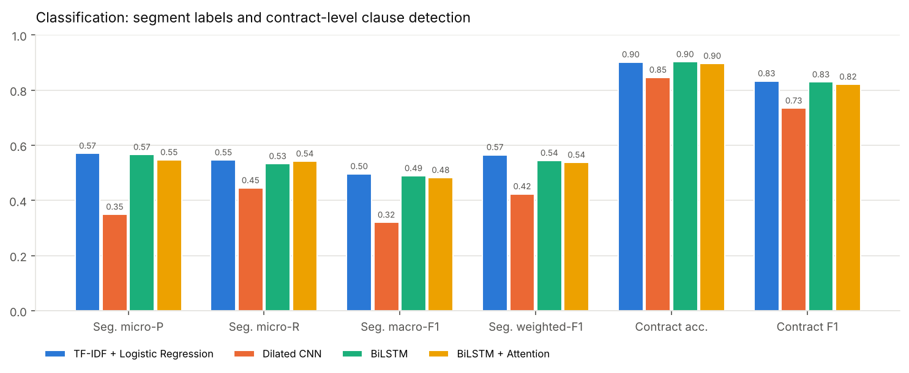
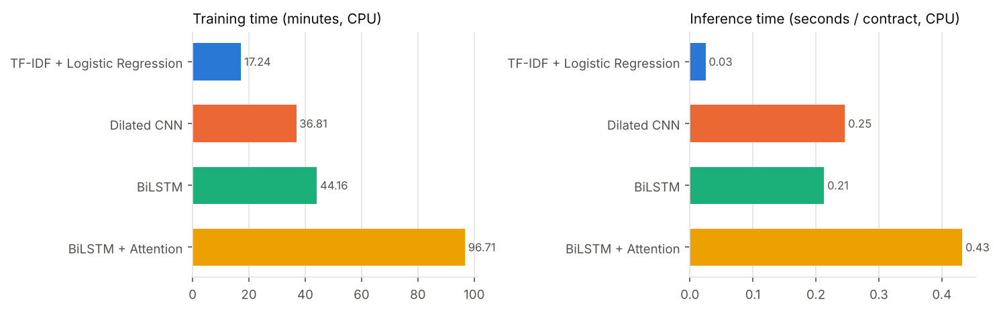
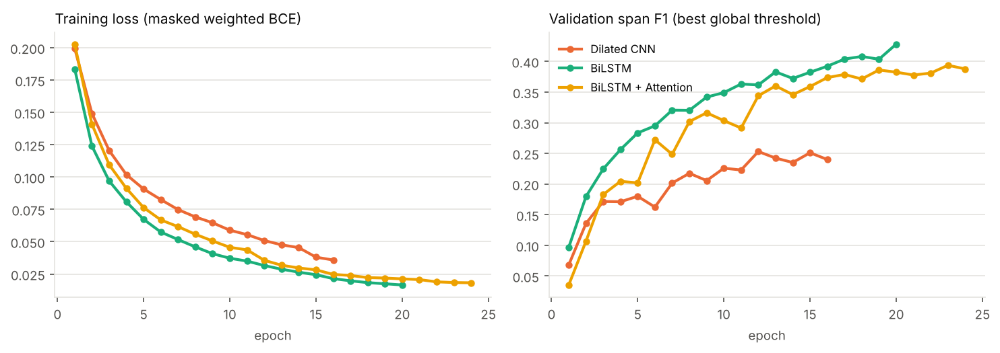
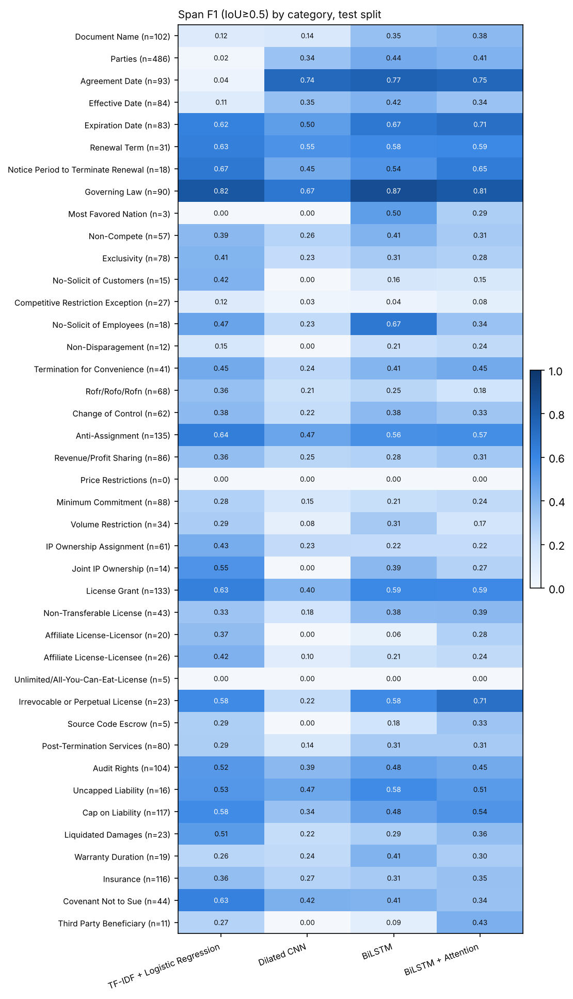
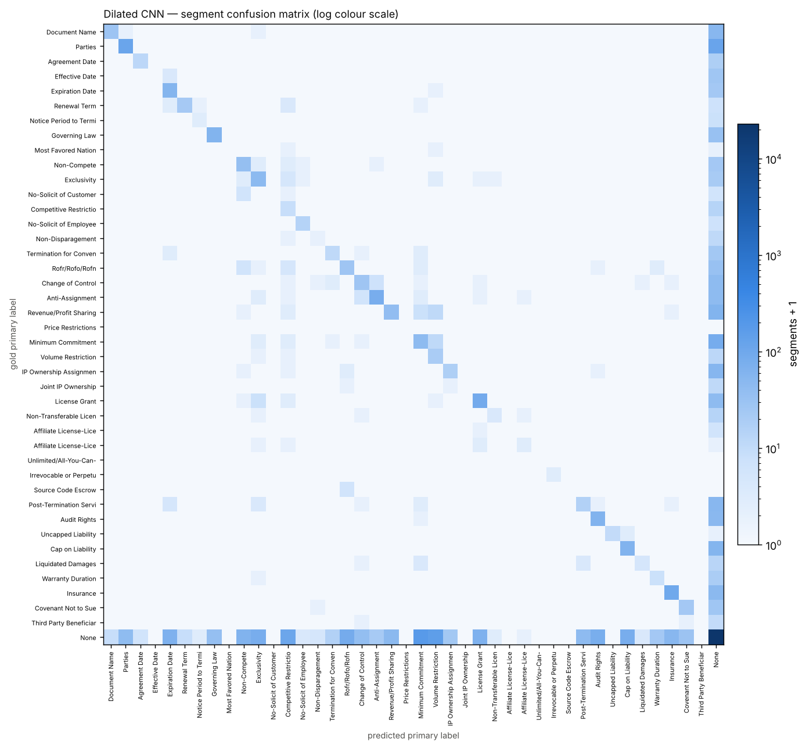
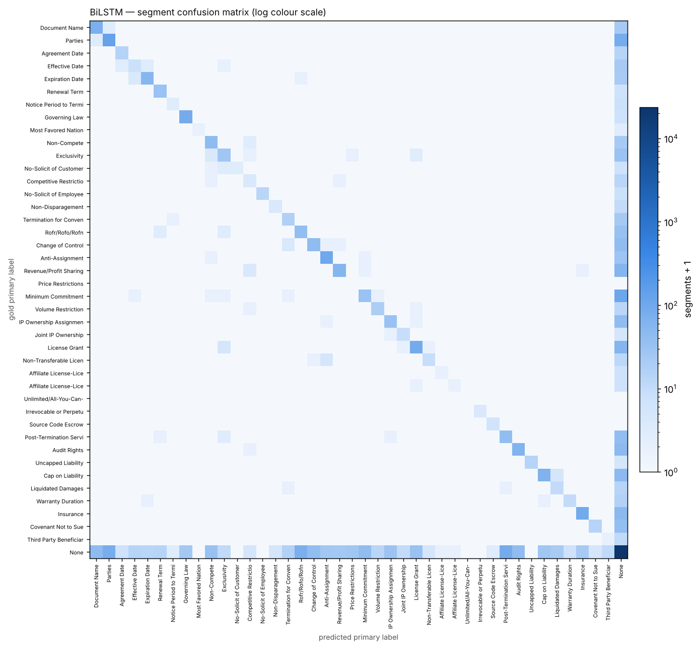
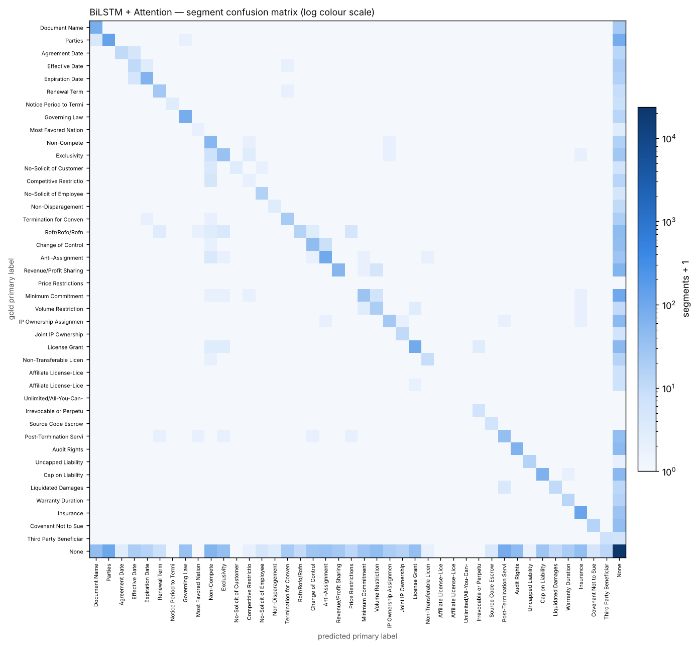

# ClauseIQ — evaluation report

Generated from `artifacts/metrics/*_test.json`. Split: **test** (102 contracts, contract-level, official CUAD test partition + seeded validation split of official train).

## Model comparison

| Model | Span F1 (IoU≥0.5) | Span P | Span R | Span macro-F1 | Exact Match F1 | Exact Match rate | Char IoU | Mean best IoU | Seg. accuracy | Seg. micro-P | Seg. micro-R | Seg. macro-F1 | Seg. weighted-F1 | Contract acc. | Contract F1 | Train time (min) | Inference s/contract |
|---|---:|---:|---:|---:|---:|---:|---:|---:|---:|---:|---:|---:|---:|---:|---:|---:|---:|
| TF-IDF + Logistic Regression | 0.353 | 0.402 | 0.315 | 0.383 | 0.172 | 0.154 | 0.364 | 0.337 | 0.924 | 0.571 | 0.547 | 0.496 | 0.566 | 0.902 | 0.833 | 17.24 | 0.03 |
| Dilated CNN | 0.304 | 0.312 | 0.297 | 0.243 | 0.097 | 0.095 | 0.236 | 0.298 | 0.891 | 0.349 | 0.445 | 0.320 | 0.423 | 0.846 | 0.734 | 36.81 | 0.25 |
| BiLSTM | 0.437 | 0.486 | 0.396 | 0.383 | 0.207 | 0.188 | 0.383 | 0.403 | 0.922 | 0.566 | 0.533 | 0.489 | 0.545 | 0.903 | 0.829 | 44.16 | 0.21 |
| BiLSTM + Attention | 0.428 | 0.463 | 0.398 | 0.380 | 0.205 | 0.191 | 0.367 | 0.405 | 0.921 | 0.547 | 0.542 | 0.483 | 0.538 | 0.897 | 0.821 | 96.71 | 0.43 |

*Span* metrics measure extraction of character spans; *Seg.* metrics are multi-label classification of sentence-like segments; *Contract* metrics are clause presence per (contract, category). See the Documentation page / README for definitions.

## Per-category span F1 (IoU ≥ 0.5)

| Category | Test gold spans | TF-IDF + Logistic Regression span F1 | Dilated CNN span F1 | BiLSTM span F1 | BiLSTM + Attention span F1 |
|---|---:|---:|---:|---:|---:|
| Document Name | 102 | 0.124 | 0.139 | 0.352 | 0.383 |
| Parties | 486 | 0.016 | 0.343 | 0.445 | 0.414 |
| Agreement Date | 93 | 0.040 | 0.738 | 0.770 | 0.745 |
| Effective Date | 84 | 0.115 | 0.355 | 0.415 | 0.343 |
| Expiration Date | 83 | 0.624 | 0.500 | 0.667 | 0.708 |
| Renewal Term | 31 | 0.635 | 0.551 | 0.583 | 0.590 |
| Notice Period to Terminate Renewal | 18 | 0.667 | 0.449 | 0.542 | 0.649 |
| Governing Law | 90 | 0.821 | 0.671 | 0.874 | 0.815 |
| Most Favored Nation | 3 | 0.000 | 0.000 | 0.500 | 0.286 |
| Non-Compete | 57 | 0.386 | 0.262 | 0.411 | 0.308 |
| Exclusivity | 78 | 0.409 | 0.225 | 0.306 | 0.280 |
| No-Solicit of Customers | 15 | 0.417 | 0.000 | 0.160 | 0.148 |
| Competitive Restriction Exception | 27 | 0.122 | 0.025 | 0.040 | 0.080 |
| No-Solicit of Employees | 18 | 0.474 | 0.231 | 0.667 | 0.343 |
| Non-Disparagement | 12 | 0.154 | 0.000 | 0.211 | 0.235 |
| Termination for Convenience | 41 | 0.451 | 0.242 | 0.406 | 0.451 |
| Rofr/Rofo/Rofn | 68 | 0.355 | 0.206 | 0.250 | 0.182 |
| Change of Control | 62 | 0.382 | 0.222 | 0.382 | 0.330 |
| Anti-Assignment | 135 | 0.638 | 0.471 | 0.560 | 0.568 |
| Revenue/Profit Sharing | 86 | 0.360 | 0.252 | 0.277 | 0.312 |
| Price Restrictions | 0 | 0.000 | 0.000 | 0.000 | 0.000 |
| Minimum Commitment | 88 | 0.275 | 0.154 | 0.214 | 0.235 |
| Volume Restriction | 34 | 0.294 | 0.077 | 0.310 | 0.167 |
| IP Ownership Assignment | 61 | 0.435 | 0.227 | 0.224 | 0.225 |
| Joint IP Ownership | 14 | 0.545 | 0.000 | 0.387 | 0.270 |
| License Grant | 133 | 0.632 | 0.401 | 0.591 | 0.587 |
| Non-Transferable License | 43 | 0.333 | 0.176 | 0.379 | 0.387 |
| Affiliate License-Licensor | 20 | 0.370 | 0.000 | 0.062 | 0.276 |
| Affiliate License-Licensee | 26 | 0.421 | 0.103 | 0.205 | 0.235 |
| Unlimited/All-You-Can-Eat-License | 5 | 0.000 | 0.000 | 0.000 | 0.000 |
| Irrevocable or Perpetual License | 23 | 0.583 | 0.222 | 0.583 | 0.706 |
| Source Code Escrow | 5 | 0.286 | 0.000 | 0.182 | 0.333 |
| Post-Termination Services | 80 | 0.291 | 0.143 | 0.308 | 0.308 |
| Audit Rights | 104 | 0.521 | 0.388 | 0.478 | 0.449 |
| Uncapped Liability | 16 | 0.529 | 0.467 | 0.581 | 0.514 |
| Cap on Liability | 117 | 0.579 | 0.344 | 0.485 | 0.543 |
| Liquidated Damages | 23 | 0.511 | 0.222 | 0.286 | 0.364 |
| Warranty Duration | 19 | 0.256 | 0.238 | 0.414 | 0.298 |
| Insurance | 116 | 0.360 | 0.267 | 0.307 | 0.351 |
| Covenant Not to Sue | 44 | 0.629 | 0.425 | 0.414 | 0.345 |
| Third Party Beneficiary | 11 | 0.267 | 0.000 | 0.091 | 0.429 |

## Confusion matrices

